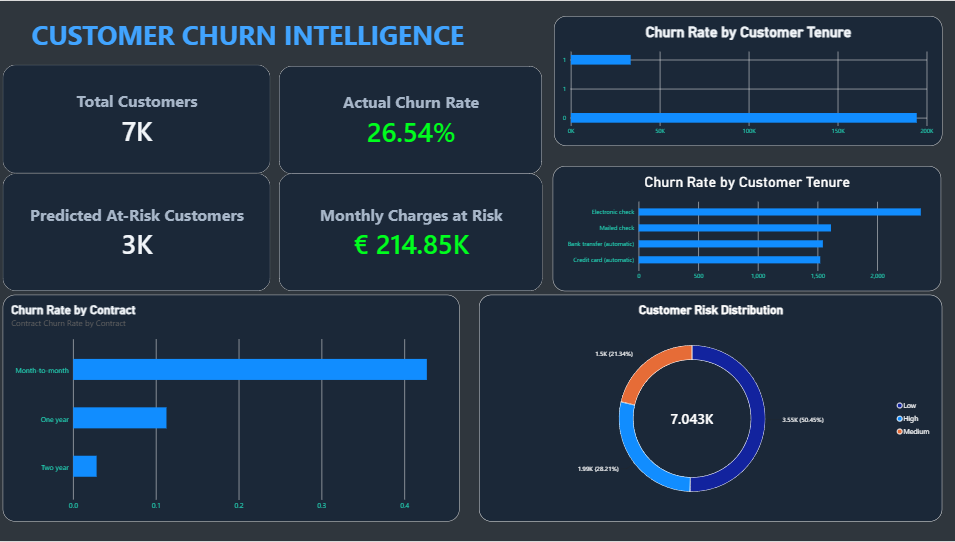

# Customer Churn Prediction & Retention Analytics

**Machine Learning · Python · Scikit-learn · Power BI · Data Analytics**

An end-to-end data analytics project that uses machine learning to identify customers at risk of leaving a telecommunications service. The project combines customer data exploration, churn prediction, risk segmentation, and an interactive Power BI dashboard to support data-driven retention strategies.

## Project Overview

Customer churn is a major challenge for subscription-based businesses. Identifying customers who are likely to leave can help companies understand customer behavior, prioritize retention efforts, and make better business decisions.

This project explores customer churn patterns and develops a machine learning workflow to estimate churn probabilities. The results are transformed into actionable insights through customer risk categories, retention recommendations, and Power BI visualizations.

## Objectives

- Explore and understand customer churn patterns.
- Clean and prepare customer data for analysis.
- Perform exploratory data analysis (EDA).
- Train and evaluate machine learning classification models.
- Estimate individual customer churn probabilities.
- Segment customers into low-, medium-, and high-risk groups.
- Recommend retention actions based on customer risk.
- Build an interactive Power BI dashboard for business analysis.

## Technologies Used

| Technology | Purpose |
|---|---|
| Python | Data processing and machine learning |
| Pandas & NumPy | Data manipulation and preparation |
| Matplotlib & Seaborn | Exploratory data analysis and visualization |
| Scikit-learn | Model training and evaluation |
| Jupyter Notebook | Analysis and experimentation |
| Power BI | Interactive reporting and business intelligence |
| Git & GitHub | Version control and project documentation |

## Dataset

The project uses the **IBM Telco Customer Churn dataset**, containing customer information, service subscriptions, billing details, contract characteristics, and churn labels.

The analysis investigates factors such as:

- Customer tenure
- Contract type
- Monthly charges
- Internet and additional services
- Payment methods
- Customer churn behavior

Dataset file:

`data/WA_Fn-UseC_-Telco-Customer-Churn.csv`

Please review the dataset's original license and redistribution terms before reusing or redistributing it.

## Project Workflow

### 1. Data Preparation
- Load and inspect the dataset.
- Check data types, missing values, and data quality.
- Prepare features and the target variable for modeling.

### 2. Exploratory Data Analysis
- Investigate churn distribution.
- Compare churn across customer groups.
- Explore relationships between contracts, tenure, charges, and churn.

### 3. Machine Learning
- Prepare features for classification.
- Train and evaluate Logistic Regression and Random Forest models.
- Analyze classification performance using appropriate evaluation metrics.
- Explore probability thresholds to support customer-risk identification.

### 4. Customer Risk Segmentation
Generate churn probabilities and categorize customers into risk groups. The resulting analysis supports prioritization of customers who may benefit from retention efforts.

### 5. Retention Strategy
Use customer risk and available customer characteristics to suggest potential retention actions. These recommendations are decision-support suggestions, not guaranteed solutions.

### 6. Power BI Dashboard
Present the analysis in an interactive business intelligence report, designed to help users explore churn patterns, monitor key indicators, and investigate retention priorities.

## Dashboard

The Power BI report includes two main pages:

**Executive Overview**
- High-level churn indicators
- Customer churn patterns
- Contract and customer characteristics
- Interactive filtering for further exploration

**Retention Strategy**
- Customer churn risk segmentation
- Customer-level churn probabilities
- Recommended retention actions
- Retention priority analysis

Power BI report: `powerbi/Customer_Marketing_Analytics.pbix`



## Project Structure

```text
customer-churn-prediction/
├── data/
│   └── WA_Fn-UseC_-Telco-Customer-Churn.csv
├── notebooks/
│   └── customer_churn_prediction.ipynb
├── outputs/
│   ├── customer_churn_dashboard.csv
│   ├── customer_churn_summary.csv
│   ├── customer_retention_priorities.csv
│   └── retention_risk_summary.csv
├── powerbi/
│   └── Customer_Marketing_Analytics.pbix
├── screenshots/
│   └── dashboard.png
├── .gitignore
└── README.md
```

## How to Run the Project

### Requirements

- Python 3.10 or a compatible Python version
- Jupyter Notebook or JupyterLab
- The Python libraries used in the notebook
- Power BI Desktop to open and interact with the `.pbix` report

### Installation

Clone the repository:

```bash
git clone https://github.com/destrox07/customer-churn-prediction.git
cd customer-churn-prediction
```

Create and activate a virtual environment (optional but recommended):

```bash
python -m venv .venv
```

On Windows PowerShell:

```powershell
.\.venv\Scripts\Activate.ps1
```

Install the required libraries:

```bash
pip install pandas numpy matplotlib seaborn scikit-learn jupyter
```

Launch Jupyter:

```bash
jupyter notebook
```

Open `notebooks/customer_churn_prediction.ipynb` and run the cells **in order, from top to bottom**. Ensure the dataset path in the notebook matches the repository structure.

To explore the dashboard, open `powerbi/Customer_Marketing_Analytics.pbix` with Power BI Desktop.

## Key Deliverables

- An exploratory data analysis and machine learning notebook.
- Churn probability predictions at customer level.
- Customer risk segmentation and retention-priority outputs.
- Exported CSV files for reporting.
- An interactive Power BI dashboard.
- A reproducible project structure using Git.

## Limitations

- Model predictions are estimates and may not generalize to other datasets or businesses.
- Churn probabilities should be interpreted in the context of model calibration and evaluation results.
- Risk categories depend on the chosen probability thresholds.
- Retention recommendations require business validation and should be tested before operational use.
- This project is intended for educational and portfolio purposes, not as a production decision system.

## Future Improvements

- Compare additional classification models and tune hyperparameters.
- Add cross-validation and more comprehensive model evaluation.
- Improve probability calibration and explain model predictions.
- Develop a reusable prediction pipeline.
- Automate the export of model results for Power BI.
- Evaluate retention strategies using business impact and cost-benefit analysis.

## Author

**Raed Hammouda**

Artificial Intelligence and Data Analytics student at the University of Trieste, Italy.

Interested in Data Analytics, Business Intelligence, Machine Learning, and AI-driven business solutions.

- GitHub: [@destrox07](https://github.com/destrox07)

---

*Built as a practical project to develop skills in data analysis, machine learning, business intelligence, and reproducible workflows.*
